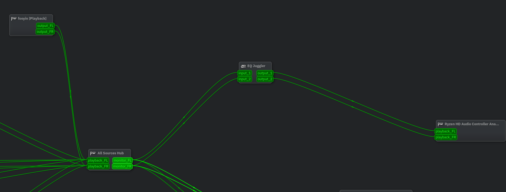
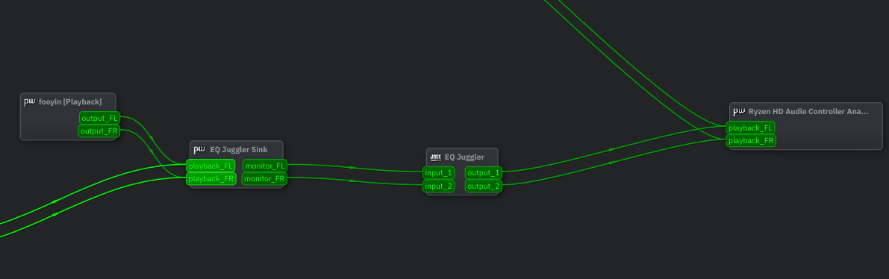

# EQ Juggler (MVP)
Load different EQ presets (in APO syntax) and compare them. Presets are loudness matched automatically.
By now you need to manually set it and program's capabilities are limited because it's MVP. EQ Juggler's node can be either connected automatically to system audio or be left unconnected. Program is only intended to be used with Pipewire and pipewire-jack as it is work as Jack client.

What it can do now:

* Apply different EQ presets to incoming audio stream from some node\[s\] and output it to other node\[s\]
* Loudness match all EQ presets so their perceived loudness is the same
* Change between EQ presets seamlessly
* Auto connect to system audio and reverting to previous state after quit

What is planed to add:

* EQ magnitude response preview
* Interactive EQ editing
* Blind comparison of EQ presets either by uploaded file or by incoming stream
* Rank EQ presets using Bradley–Terry model
* EQ for channel matching

## Installation
```bash
pip install -r requirements.txt
```

## How to setup
There are 2 blocks of comments on line 56 and line 194 of `main.py` that will help you with specifying your EQ presets and modifying loudness match strategy if you need to.

## How to run
```bash
python main.py
```

And wait for GUI window to appear (it can take some time). Then connect EQ Juggler's node as you wish if you set `NODE_AUTO_CONNECT` to _False_.

Routing example if `NODE_AUTO_CONNECT` is _False_:


Routing example if `NODE_AUTO_CONNECT` is _True_:

